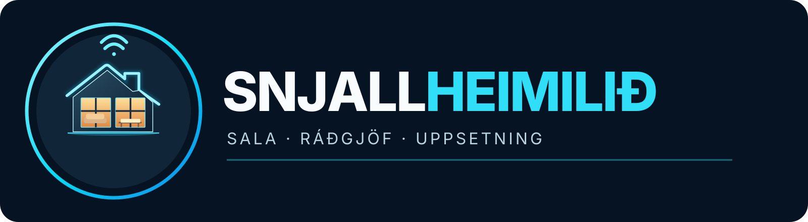

# Snjallheimilið

Heimasíða Snjallheimilisins: snjallvæðing heimila á Akureyri. Kyrrstæð síða (HTML, CSS, vanilla JS), hýst á
GitHub Pages, ætluð léninu `snjallheimilid.is`.

Verðáætlunin sem síðan vísar á er í [smart-home-estimator](https://github.com/TheIcelandicguy/smart-home-estimator)
(`quick.html`); slóðin er `AETLUN` í `site.js`.

## Keyra

```bash
python -m http.server 8766
```

Opna http://localhost:8766/. Engin bygging.

## Leyfi og myndir

Kóðinn (HTML, CSS, JS) er undir MIT-leyfi, sjá `LICENSE`. Textinn og merkið eru höfundarréttur
Snjallheimilisins og fylgja ekki leyfinu.

Vörumyndirnar í `img/products/` eru ekki Snjallheimilisins. Þær eru úr vörulistum framleiðenda og söluaðila,
eru eign framleiðendanna og eru sýndar á síðunni til að auðkenna vörurnar. Þær fylgja ekki MIT-leyfinu og
má ekki nota áfram án leyfis eigenda sinna:

- `img/products/shelly/`: Shelly
- `img/products/plejd/`: Plejd
- `img/products/tuya/`: BSEED
- `img/products/innlagnaefni/`: Legrand (`leg_*`, `val_*`) og Schneider Electric, Merten (`mer_*`)

Tölvugerðu þrívíddarmyndirnar í `img/lines3d/` og teikningarnar á síðunni eru eigin verk Snjallheimilisins.
Vörumerki eru eign eigenda sinna.
